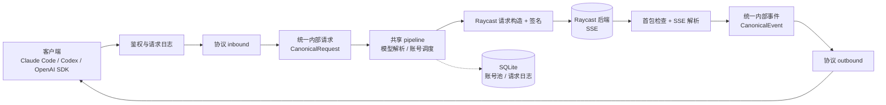

<div align="center">

# raycast2api

**把 Raycast AI 后端包装成 OpenAI / Anthropic 兼容的 HTTP 网关**

Claude Code、Codex 以及各类 OpenAI 兼容客户端，直接把请求打到本地网关即可。<br>
协议转换、请求签名、账号池调度与流式响应聚合，全部由网关负责。

[](https://www.rust-lang.org/)
[](https://github.com/jwyGithub/raycast2api/tags)
[](https://github.com/jwyGithub/raycast2api/pkgs/container/raycast2api)
[](https://github.com/jwyGithub/raycast2api/actions/workflows/docker-publish.yml)
[](https://github.com/jwyGithub/raycast2api/commits/main)
[](https://github.com/jwyGithub/raycast2api/stargazers)
[](https://github.com/jwyGithub/raycast2api/issues)

[特性](#特性) ·
[快速开始](#快速开始) ·
[接口一览](#接口一览) ·
[配置](#配置) ·
[账号池](#账号池与故障切换) ·
[管理控制台](#管理控制台) ·
[架构](#架构) ·
[文档](#文档)

</div>

---

> 上游接口 `POST https://backend.raycast.com/api/v1/ai/chat_completions` **始终以 SSE 流式返回**。网关的"非流式"响应，是把整条流聚合后一次性返回的结果。

## 特性

| 能力 | 说明 |
| --- | --- |
| 三种客户端协议，一个上游 | 按**请求路径**判定协议（不做请求头 / 字段探测），分别适配 OpenAI Chat Completions、Anthropic Messages、OpenAI Responses |
| 流式与非流式 | 三条路径都同时支持 SSE 流式与聚合后的非流式响应 |
| 请求签名 | 自动计算 `X-Raycast-Signature-v2`（ROT13/ROT5 + HMAC-SHA256） |
| 多账号池 | SQLite 账号池，轮询分摊额度；401 自动续期、限额自动冷却、换号重试 |
| 模型直通 | `GET /v1/models` 透出账号可用模型，并补充 Sub2API 可读取的通用元数据 |
| 推理强度映射 | Messages 的 `output_config.effort` / `thinking`、Responses 的 `reasoning.effort` 映射到 Raycast 的 effort |
| 请求日志 | 入站体、上游请求体、上游 SSE 响应存入 SQLite，保留 7 天自动清理 |
| 管理控制台 | 内置 Web 页面（`GET /`），管理账号池、查看请求日志与上游调用统计 |
| 上游代理链 | 支持 http / https / socks5，可配置代理优先或直连优先 |
| 访问鉴权 | 控制台使用 Redis Session；管理接口支持 Session 或 API Key，推理接口使用 API Key |
| 双栈监听 | 绑定 `0.0.0.0` 时自动同时监听 IPv6 `[::]` |

## 快速开始

### 获取 device_id

`raycast_device_id` 必须与你本机 Raycast 客户端使用的设备 ID 一致，`deploy/` 下的脚本可以在本机直接推导出来。算法为 `device_id = SHA256(uuid + identifyingNumber + SALT + "Production")`，只读取本机硬件标识，不联网。

| 平台 | 命令 | 数据来源 |
| --- | --- | --- |
| Windows | `pwsh ./deploy/get_device_id.ps1` | WMI `Win32_ComputerSystemProduct` 的 `UUID` 与 `IdentifyingNumber` |
| macOS | `./deploy/get_device_id.sh` | `ioreg` 的 `IOPlatformUUID` 与 `IOPlatformSerialNumber` |

输出示例：

```text
uuid:               XXXXXXXX-XXXX-XXXX-XXXX-XXXXXXXXXXXX
identifyingNumber:  XXXXXXXXXXXX

device_id: 64 位十六进制字符串
```

把最后一行的 `device_id` 填入 `config.json` 的 `raycast_device_id`。

> Windows 脚本的推导算法当初已用真实抓包请求验证。macOS 脚本沿用 Windows 客户端提取的盐值与 `Production` 后缀，尚未与真实 macOS 抓包逐一比对：首次使用时，建议把输出与本机客户端请求里的 `X-Raycast-DeviceId` 请求头对一下。

### 方式一：Docker Compose（推荐）

`docker-compose.yml` 默认拉取 CI 发布到 GHCR 的镜像 `ghcr.io/jwygithub/raycast2api:latest`。应用配置通过只读挂载的 `config.json` 提供，Redis 连接通过 Compose 的 `REDIS_*` 环境变量提供，连接已有 Redis 服务。

```bash
git clone https://github.com/jwyGithub/raycast2api.git
cd raycast2api

cp config.example.json config.json
# 编辑 config.json，填写 Raycast 配置、dashboard_password 和 dashboard_session_secret，建议同时设置 api_key
# 配置 Compose 中的 REDIS_HOST / REDIS_PORT；需要认证时在 .env 中填写 REDIS_USERNAME / REDIS_PASSWORD

docker compose up -d
```

* `config.json` 中的 `host` 保持 `0.0.0.0`、`port` 保持 `8787`，与容器端口映射一致；配置文件缺失时容器启动会报错。
* 账号池与请求日志持久化在 `./store`。
* compose 里的 `user: '1000:1000'` 让容器以宿主机用户身份写入 `./store`；如果你的 uid / gid 不同（`id -u` / `id -g`），请按实际值修改，否则 SQLite 会报 `unable to open database file`。
* 想用本地源码构建，把 `image:` 那一行注释掉，改用 `build: .`。
* 默认 Redis 地址为 `host.docker.internal:6379`；已通过 `extra_hosts` 为 Linux Docker 添加宿主机地址映射，Redis 需要监听容器可达的地址。
* 容器每 30 秒请求本地 `/health`，单次超时 5 秒，启动宽限期 30 秒，连续失败 3 次标记为 `unhealthy`；该检查仅验证网关存活，不检查上游账号或 Redis。镜像需包含本次新增的 `curl`，旧镜像请更新或用本地源码构建。健康状态本身不会触发 `restart: unless-stopped` 自动重启。
* 修改 `config.json` 后执行 `docker compose restart`；修改 Compose 环境变量后执行 `docker compose up -d` 重建容器。镜像尚未包含此改动时需使用本地源码构建。

### 方式二：源码运行

需要 Rust 工具链（edition 2024，建议最新稳定版）。

```bash
cp config.example.json config.json   # 填入配置

REDIS_HOST=127.0.0.1 cargo run --release  # 默认监听 0.0.0.0:8787
```

启动后访问 `http://localhost:8787/` 打开[管理控制台](#管理控制台)，输入配置的 `dashboard_password` 后进入，或用下面的示例直接请求。若未设置 `api_key`，推理和模型接口接受未鉴权请求，管理接口仍要求有效 Session。

### 添加账号

网关需要至少一个 Raycast 账号才能转发请求，通过 `POST /v1/accounts/create` 导入（按 `user.email` 去重，token 变化时更新；支持单个对象或数组）：

```bash
curl http://localhost:8787/v1/accounts/create \
  -H "Authorization: Bearer <你的 api_key>" \
  -H "Content-Type: application/json" \
  -d '{
    "tag": "main",
    "user": { "email": "you@example.com" },
    "access_token": "<access_token>",
    "refresh_token": "<refresh_token>",
    "obtained_at": "2026-11-12T00:00:00Z"
  }'
```

`refresh_token` 可选，但建议提供：token 失效时网关会用它自动续期，而不是直接摘号。

## 使用示例

以下示例假设网关运行在 `http://localhost:8787`。若设置了 `api_key`，鉴权头两种形式任选其一：

* OpenAI 风格：`-H "Authorization: Bearer <你的 api_key>"`
* Anthropic 风格：`-H "x-api-key: <你的 api_key>"`（Claude Code / Anthropic SDK 默认发送后者）

两个头都带时，优先取 `Authorization: Bearer`。Chat Completions 的 `model` 必填；Messages / Responses 省略时使用 `openai-gpt-6.1-sol`。所有端点均在应用 `model_overrides` 后检查模型列表，未知模型返回 404，不再静默替换为默认模型。

**OpenAI Chat Completions（流式）**

```bash
curl http://localhost:8787/v1/chat/completions \
  -H "Content-Type: application/json" \
  -d '{
    "model": "openai-gpt-6.1-sol",
    "stream": true,
    "stream_options": {"include_usage": true},
    "messages": [{"role": "user", "content": "你好"}]
  }'
```

Chat Completions 当前支持文本和 function 工具调用，按 [OpenAI Chat Completions 规范](https://developers.openai.com/api/reference/resources/chat/subresources/completions/methods/create)处理以下字段：

* `messages`：支持 `system`、`developer`、`user`、`assistant`、`tool`；内容支持字符串与 `text` 分块数组；system / developer 指令按出现顺序合并到上游 `additional_system_instructions`。assistant 工具调用允许 `content: null` 或省略 content，工具结果通过 `tool_call_id` 关联；历史调用必须有对应结果。
* `tools` / `tool_choice`：支持 function 定义及 `auto`、`none`、`required`、指定函数；保留混合输出中的文本和工具调用。网关把调用交给客户端执行。
* `temperature`：范围 0–2，默认 1；`reasoning_effort`：支持 `low`、`medium`、`high`、`xhigh`，传给上游。历史 reasoning 内容不回放。
* `stream_options.include_usage`：仅在 true 时发送 usage 尾帧，此时普通帧带 `usage: null`；默认不发送 usage。成功流以 `[DONE]` 结束，失败流发送 error，不伪造完成帧。

尚未确认 Raycast 支持的生成参数会返回 400，包括 `max_tokens` / `max_completion_tokens`、`stop`、JSON 输出格式、`strict: true`、非默认采样或惩罚参数、`n > 1`、`parallel_tool_calls: false`、图片／音频内容、非 tool 消息的 `name` 等。允许与当前行为一致的默认值，如 `n: 1`、`top_p: 1`、`response_format: {"type":"text"}`；`user` / `safety_identifier` 仅接受字符串，不转发给上游。不支持的字段不再静默忽略。

无效 JSON、字段类型错误和请求校验失败均返回 JSON error；超出 16 MiB 的请求保留 413。上游 400 / 413 / 422 / 429 / 503 / 504 保留状态码；上游账号 401 / 403 仍作为 502，避免误报为客户端 API Key 失效。上游返回 `length` / `content_filter` 时保留结束原因，Messages / Responses 同步映射为对应的停止或 incomplete 状态。

**Anthropic Messages**

```bash
curl http://localhost:8787/v1/messages \
  -H "Content-Type: application/json" \
  -d '{
    "model": "openai-gpt-6.1-sol",
    "max_tokens": 1024,
    "messages": [{"role": "user", "content": "你好"}]
  }'
```

**OpenAI Responses**

```bash
curl http://localhost:8787/v1/responses \
  -H "Content-Type: application/json" \
  -d '{
    "model": "openai-gpt-6.1-sol",
    "input": "你好",
    "reasoning": { "effort": "medium" }
  }'
```

**列出可用模型**

```bash
curl http://localhost:8787/v1/models
```

## 接口一览

### 推理与健康检查

| 路径 | 协议 | 典型客户端 |
| --- | --- | --- |
| `POST /v1/messages` | Anthropic Messages | Claude Code |
| `POST /v1/responses` | OpenAI Responses | Codex |
| `POST /v1/chat/completions` | OpenAI Chat Completions | 各类 OpenAI 兼容客户端 |
| `GET /v1/models` | 模型列表（5 分钟缓存） | — |
| `GET /health` | 存活探针，**无需鉴权** | — |
| `GET /ready` | 就绪探针，**无需鉴权**；没有可用账号或上游被限流时返回 not ready | — |

三个推理接口的请求体上限为 16 MiB。

### 账号、日志与统计管理

登录接口和管理接口（`/v1/login`、`/v1/accounts/*`、`/v1/logs/*`、`/v1/statistics/*`）统一返回 `{ code, message, data }`：列表与分页对象放在 `data` 中；删除成功返回 HTTP 200 和 `data: null`；错误响应也使用此包络，错误原因位于 `message`，`data` 为 `null`。模型列表、三种推理接口以及 `/health`、`/ready` 保持各自协议的响应格式。

| 路径 | 说明 |
| --- | --- |
| `POST /v1/login` | 校验 JSON body 中的 `dashboard_password`；签发 HttpOnly Cookie，返回 `data.expires_in: 86400`，密码错误返回 HTTP 401 |
| `POST /v1/session` | 校验 Cookie Session；成功返回 `data.authenticated: true`，无效或过期返回 HTTP 401 |
| `POST /v1/logout` | 校验并删除 Redis Session，同时清除 Cookie；成功返回 `data: null` |
| `POST /v1/accounts/list` | 账号列表（body：`page`、`page_size`、`status`；默认每页 10 个，`page_size` 取值 1 到 100） |
| `POST /v1/accounts/detail` | 单账号信息（body：`email`） |
| `POST /v1/accounts/create` | 新增 / 更新账号（按 email upsert；支持单个对象或账号数组） |
| `POST /v1/accounts/delete` | 按 `email` 删除单个账号，或按 `status` 批量删除（`available`、`cooldown`、`unavailable`）；同时传入时需邮箱和状态都匹配 |
| `POST /v1/accounts/restore` | 手动恢复账号（body：`email`） |
| `POST /v1/accounts/refresh` | 刷新指定账号额度（body：`email`） |
| `GET /v1/accounts/export` | 导出可直接提交给 `create` 的账号 JSON 数组（含明文 token；**必须配置 `api_key`** 才可用） |
| `POST /v1/logs/list` | 请求日志列表（body：`page`、`page_size`、`created_at`、`request_id`；默认每页 10 条，不含请求体） |
| `POST /v1/logs/detail` | 请求日志详情（body：`request_id`；返回入站 / 上游 / 响应全文） |
| `POST /v1/statistics/list` | 上游调用统计分页明细，默认每页 10 条，支持时间、请求 ID、账号、模型、key 指纹等精确筛选；见[统计接口](doc/statistics.md) |
| `POST /v1/statistics/detail` | 单次上游尝试的详情（body：`id`，由统计列表返回），包含完整 usage |

日志列表与详情中的 `model` 为客户端请求的模型，`upstream_model` 为应用映射后实际发给上游的请求体中的模型。未发送上游请求、上游请求体不含模型或升级前的历史日志，该字段为 `null`。已有数据库启动时会自动补列。

统计独立存储在同一个 SQLite 库的 `statistics` 表中，启动时自动建表，不受日志 7 天清理影响。每次实际上游尝试独占一条记录；摘要、换号、token 续期后重发、代理切换及断流重试通过同一个 `request_id` 关联。控制台统计面板提供筛选、分页与详情；跨页聚合尚未实现。

## 配置

应用配置从项目根目录的 `config.json` 读取；Redis 连接单独读取下表中的环境变量。文件缺失、格式错误，或缺少必填项 `raycast_device_id` / `raycast_signature_secret` 时，网关会报错退出。启用控制台还必须配置非空密码、至少 32 字节的 Session 密钥和可连接的 Redis。

```json
{
  "host": "0.0.0.0",
  "port": 8787,
  "api_key": "your-api-key-here",
  "dashboard_password": "your-dashboard-password-here",
  "dashboard_session_secret": "replace-with-a-random-secret-at-least-32-bytes",
  "raycast_device_id": "your-raycast-device-id",
  "raycast_signature_secret": "your-raycast-signature-secret",
  "proxies": [],
  "proxies_enabled": false,
  "upstream_timeout_secs": 20,
  "model_overrides": {}
}
```

| 配置项 | 必填 | 默认 | 说明 |
| --- | --- | --- | --- |
| `raycast_device_id` | 是 | — | Raycast 设备 ID，同时参与签名计算；获取方式见[获取 device_id](#获取-device_id) |
| `raycast_signature_secret` | 是 | — | `X-Raycast-Signature-v2` 的 HMAC 签名密钥，网关不再内置默认值；空字符串视为未填写 |
| `api_key` | 否 | 无 | 推理认证凭据，也可调用管理接口；未配置时仅推理和模型接口免鉴权；登录不返回此 Key |
| `dashboard_password` | 否 | 无 | 控制台登录密码；未配置或为空时无法登录页面，原有 API key 调用仍可用；修改后重启生效 |
| `dashboard_session_secret` | 启用控制台时必填 | 无 | 至少 32 字节的随机密钥，用于签名 Session Cookie；修改密码或密钥并重启后，旧 Session 失效 |
| `accounts_db` | 否 | `store/store.db` | SQLite 存储库路径（账号、请求日志、统计共用） |
| `host` | 否 | `0.0.0.0` | 监听地址（须为 IP） |
| `port` | 否 | `8787` | 监听端口 |
| `upstream_timeout_secs` | 否 | `20` | 上游超时秒数，必须为正整数；用于连接、响应头、首包、SSE 空闲及普通查询 / OAuth。修改后重启生效，流式任务只要持续有输出，总时长可以超过此值 |
| `proxies` | 否 | `[]` | 上游代理链，http / https / socks5 URL 数组。启动时会校验协议前缀，写错直接报错 |
| `proxies_enabled` | 否 | `false` | 代理通道模式：`false` 为直连优先，网络错误时按顺序换代理重试；`true` 为代理优先，全部失败再回退直连。两种模式都要求 `proxies` 非空才生效 |
| `model_overrides` | 否 | `{}` | 客户端模型 ID 到网关模型 ID 的别名表，例如 `{"gpt-6-astra": "openai-gpt-6-astra"}`，在查找上游模型之前应用 |

日志级别通过 `RUST_LOG` 控制（基于 `tracing-subscriber` 的 env-filter），默认 `info,tower_http=info`。

| Redis 环境变量 | 默认值 | 说明 |
| --- | --- | --- |
| `REDIS_HOST` | 无；Compose 为 `host.docker.internal` | Redis 主机；未配置时不连接 Redis，控制台不可启用 |
| `REDIS_PORT` | `6379` | TCP 端口，范围 1 到 65535 |
| `REDIS_USERNAME` | 无 | 可选 ACL 用户名 |
| `REDIS_PASSWORD` | 无 | 可选认证密码，按原值传递，无需 URL 编码 |
| `REDIS_DB` | `0` | 非负数据库编号 |
| `REDIS_KEY_PREFIX` | `raycast2api` | Key 命名空间，多实例共享 Session 时需相同 |

可用 `openssl rand -hex 32` 生成 Session 密钥。Redis 使用可自动重连的异步连接，单次连接和响应超时均为 3 秒；已配置 Redis 却无法连接时，启动失败。运行中故障时 Session 请求返回 HTTP 503；API Key 鉴权不依赖 Redis。Redis 暂未支持 TLS，当前连接应使用可信网络。

自动压缩的摘要缓存与实测输入 Token 缓存也复用该 Redis，Key 为 `<prefix>:compact:v1:summary:<SHA256>` / `usage:<SHA256>`，TTL 均为 30 分钟。按提示词配置和消息历史批量匹配最长前缀，支持跨应用重启复用。每次缓存读写独立限制为 100 毫秒，运行中故障回退本地缓存或估算，不中断推理。Redis 中会保存摘要正文，请按对话数据保护其访问和备份；详细规则见 [Redis 使用说明](./doc/redis.md)。

## 推理强度（reasoning effort）

网关把客户端的推理强度映射为 Raycast 的 `low` / `medium` / `high` / `xhigh`：

| 协议 | 来源 | 规则 |
| --- | --- | --- |
| Anthropic Messages | `output_config.effort`（优先） | `low`、`medium`、`high`、`xhigh` 原样映射；`max` 压成 `xhigh`；其他值回落为 `high` |
| | `thinking.budget_tokens` | 32k 及以上为 `xhigh`，16k 及以上为 `high`，4k 及以上为 `medium`，更低为 `low` |
| | `thinking` 开启但没有预算（`adaptive`） | `high` |
| | `thinking` 关闭或缺省 | 不传 effort |
| OpenAI Responses | `reasoning.effort` | 与上表第一行相同：`low`、`medium`、`high`、`xhigh` 原样映射，`max` 压成 `xhigh`，其他值（包括 `minimal`）回落为 `high`；有 `reasoning` 对象但没有 `effort` 时为 `high` |
| OpenAI Chat Completions | — | 不映射推理强度 |

## 账号池与故障切换

* **轮询**：请求在可用账号之间轮询，分摊额度。
* **401（token 失效）**：先用账号的 `refresh_token` 自动换新并当场重试。续期按账号串行化，锁内会重读凭据；新 token 对原子写回，写入成功才算续期成功。只有无法续期（没有 `refresh_token` 或 `invalid_grant`）才摘号换下一个账号；网络错误、5xx 等临时失败不会直接摘号。
* **限额**：上游以 200 + 流内错误返回（见下方说明）。网关给该账号设置冷却期，取上游 `retry_after`，缺省 10 分钟，并限制在 1 分钟到 24 小时之间，然后换号重试；冷却到点自动恢复。
* **邮箱未确认（403 confirm email）**：冷却 24 小时，确认后可通过 `POST /v1/accounts/restore` 立即恢复。
* **全部不可用**：池内所有账号都不可用时，把上游真实错误透传给客户端。
* **额度刷新**：启动时立即刷新一遍，之后每 6 小时一遍（401 账号同样先自动续期再查额度），并自动摘除试用已到期（`trial_days_left <= 0`）的账号。也可以用 `POST /v1/accounts/refresh` 手动刷新单个账号。

**上游限额行为**：Raycast 试用账号有 **25 次 / 小时** 的对话次数限额（Pro 账号按额度计）。限额触发时，上游**不返回 HTTP 错误状态**，而是返回 200 + SSE 流，错误藏在流内的一个 payload 里：

```json
{"error":{"message":"You've reached your free trial limit of 25 AI requests per hour...","code":"usage_limit_reached","http_status":429,"retry_after":447}}
```

网关会解析流内错误，并转成客户端协议的标准错误帧（OpenAI 系 `{"error":{...}}`、Anthropic `event: error`、Responses `response.failed`），错误信息透传，不会无声结束。额度窗口过后账号自动恢复，无需处理。

## 管理控制台

浏览器访问网关根路径 `http://localhost:8787/` 即可打开内置的 **Raycast 管理控制台**，用于查看和管理账号池、翻阅请求日志及上游调用统计。

* 页面启动和刷新时先调用 `POST /v1/session` 恢复会话；没有有效会话时输入控制台密码登录。登录成功后通过 HttpOnly Cookie 携带 Session，前端不会获得网关 API Key，也不向 localStorage / sessionStorage 写入凭据。
* Session 固定有效 24 小时，不随请求续期，退出登录立即删除 Redis 记录。Session Key 使用 Token 的 SHA-256 摘要，值固定为 `1`；Cookie 使用 256 位安全随机数和 HMAC-SHA256 签名。更换密码或 Session 密钥并重启后，旧会话失效；Redis 记录丢失时需重新登录。
* Cookie 设置 `HttpOnly; SameSite=Strict; Path=/v1`。HTTPS 反向代理需覆盖传入的 `X-Forwarded-Proto` 并设置为 `https`，网关据此添加 `Secure`。Cookie 调用管理接口、`/v1/session`、`/v1/logout` 时必须携带 `X-Dashboard-Request: 1`；页面已自动携带。
* 管理接口接受有效 Session 或配置的 API Key；推理和模型接口沿用 API Key 规则，Session 不提供推理授权。账号导出仍要求配置 `api_key`。
* 页面样式与脚本通过 CDN 加载（Tailwind、GSAP、flatpickr），需要浏览器能访问 jsDelivr。
* 统计面板支持请求 ID、账号、请求 / 上游模型、完整 API Key、状态、调用类型与请求时间范围筛选。时间统一按北京时间选择和显示；详情显示脱敏 Key、错误原因、客户端推理配置及完整 Usage。客户端的 effort 与 thinking 参数合并展示，上游推理强度单独列出。列表底部的总调用次数覆盖全部匹配记录，不代表客户端请求数；上游未上报的用量显示为 `—`。

## 架构

网关采用"协议适配层 → 统一内部模型 → 上游适配层"的分层设计，客户端协议与上游 Raycast 互不感知，任意一侧都可以独立演进：



| 模块 | 职责 |
| --- | --- |
| `config` | 静态端点常量与运行时 `Settings` |
| `core` | 与协议、供应商无关的**统一内部模型** |
| `protocol` | 三种客户端协议各自的 wire / inbound / outbound 适配器 |
| `raycast` | 唯一与上游耦合的层：请求构造、签名客户端、传输与代理回退、首包检查、SSE 解析、模型解析 |
| `account` | 账号存储、token 续期、额度刷新 |
| `signature` | `X-Raycast-Signature-v2` 计算 |
| `server` | HTTP 层：状态、中间件、路由、handler、共享推理 pipeline、Responses 上下文压缩 |
| `log` | 请求日志：SQLite 存储（7 天保留）与请求关联 ID |
| `statistics` | 独立记录每次上游尝试的账号、模型、状态及完整 usage，提供分页明细与详情 |

### 项目结构

```text
src/
  main.rs          装配、监听、定时刷新与日志维护
  config.rs        运行时配置与静态端点常量
  signature.rs     X-Raycast-Signature-v2 计算
  db.rs            SQLite 连接
  core/            统一内部请求 / 响应 / 事件模型
  protocol/        chat_completions / messages / responses 三套适配器
  raycast/         上游客户端、请求构造、传输、首包检查、SSE 解析、模型解析
  account/         账号存储、token 续期、额度刷新
  server/          路由、中间件（鉴权 / 日志捕获）、handler、状态、pipeline
    handlers/
      management/  控制台登录、账号、请求日志、上游调用统计接口
      inference/   Chat Completions / Messages / Responses 与模型列表接口
      health.rs    公共健康与就绪探针
      mod.rs       入口分类与公共兜底处理
  log/             请求日志存储与请求关联 ID
  statistics/      上游尝试统计存储、生命周期采集与查询结构
  page/            管理控制台前端文件（rust-embed 嵌入，新增文件无需改 Rust）
    components.js  共享组件注册与 message 导出入口
    components/    tooltip.js / message.js / button.js / select.js / date-picker.js
    views.js       控制台登录、导航与公共请求入口
    views/         accounts.js / logs.js / statistics.js 各自维护面板
deploy/            device_id 推导脚本（Windows .ps1 / macOS .sh）
doc/               架构、时序图、上游协议抓包说明
tests/             契约测试与签名一致性测试
```

HTTP 入口按管理与推理分类，各自的 `mod.rs` 负责组装路由，`server/mod.rs` 统一挂载 `/v1` 和公共中间件。控制台登录、Session 校验和退出独立注册；后两者在 handler 内校验 Session。健康探针保留鉴权豁免。

## 测试

```bash
cargo test
```

`tests/` 下覆盖三种协议的契约测试、消息转换、请求构造、错误映射、ID 派生、账号与日志接口契约，以及签名一致性（`signature_parity`，用固定的占位 device_id / secret 生成黄金向量）。

## 发布

推送形如 `v1.2.3` 的 tag 会触发 [GitHub Actions](./.github/workflows/docker-publish.yml)，构建镜像并推送到 GHCR：`ghcr.io/jwygithub/raycast2api`。可用标签见[包页面](https://github.com/jwyGithub/raycast2api/pkgs/container/raycast2api)。

## 文档

| 文档 | 内容 |
| --- | --- |
| [`doc/architecture.md`](./doc/architecture.md) | 详细架构设计 |
| [`doc/sequence-diagrams.md`](./doc/sequence-diagrams.md) | 请求时序图 |
| [`doc/raycast-backend-protocol.md`](./doc/raycast-backend-protocol.md) | 上游 Raycast 后端接口的抓包协议 |
| [`doc/model-degradation.md`](./doc/model-degradation.md) | 上游模型降级机制与断流排查 |
| [`doc/architecture-optimization-2026-11-12.md`](./doc/architecture-optimization-2026-11-12.md) | 当前实现、修复 TODO 与部署限制 |
| [`doc/redis.md`](./doc/redis.md) | Redis Session、压缩缓存、其他可用场景与多实例边界 |

## 安全提示

* `bearer_token`、`device_id`、`api_key` 等属于敏感信息。`config.json`、`.env`、`account.json`、`accounts/`、`store/` 都已在 `.gitignore` 中忽略，请勿提交。
* `store/store.db`（SQLite 存储库，含账号凭据与请求日志全文）包含明文凭据，切勿暴露。
* `GET /v1/accounts/export` 会返回明文 token，只有配置了 `api_key` 才能调用，请妥善保管该 key。
* 对公网暴露网关时，务必设置 `api_key`；未设置时推理和模型接口接受未鉴权请求。
