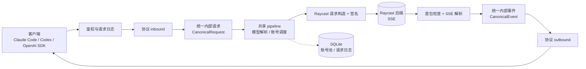

<div align="center">

# raycast2api

**把 Raycast AI 后端包装成 OpenAI / Anthropic 兼容的 HTTP 网关**

Claude Code、Codex 以及各类 OpenAI 兼容客户端，直接把请求打到本地网关即可。<br>
协议转换、请求签名、账号池调度与流式响应聚合，全部由网关负责。

[](https://www.rust-lang.org/)
[](https://github.com/jwyGithub/raycast2api/tags)
[](https://github.com/jwyGithub/raycast2api/pkgs/container/raycast2api)
[](https://github.com/jwyGithub/raycast2api/actions/workflows/docker-publish.yml)
[](https://github.com/jwyGithub/raycast2api/commits/main)
[](https://github.com/jwyGithub/raycast2api/stargazers)
[](https://github.com/jwyGithub/raycast2api/issues)

[特性](#特性) ·
[快速开始](#快速开始) ·
[接口一览](#接口一览) ·
[配置](#配置) ·
[账号池](#账号池与故障切换) ·
[管理控制台](#管理控制台) ·
[架构](#架构) ·
[文档](#文档)

</div>

---

> 上游接口 `POST https://backend.raycast.com/api/v1/ai/chat_completions` **始终以 SSE 流式返回**。网关的"非流式"响应，是把整条流聚合后一次性返回的结果。

## 特性

| 能力 | 说明 |
| --- | --- |
| 三种客户端协议，一个上游 | 按**请求路径**判定协议（不做请求头 / 字段探测），分别适配 OpenAI Chat Completions、Anthropic Messages、OpenAI Responses |
| 流式与非流式 | 三条路径都同时支持 SSE 流式与聚合后的非流式响应 |
| 请求签名 | 自动计算 `X-Raycast-Signature-v2`（ROT13/ROT5 + HMAC-SHA256） |
| 多账号池 | SQLite 账号池，轮询分摊额度；401 自动续期、限额自动冷却、换号重试 |
| 模型直通 | `GET /v1/models` 透出账号可用模型，并补充 Sub2API 可读取的通用元数据 |
| 推理强度映射 | Messages 的 `output_config.effort` / `thinking`、Responses 的 `reasoning.effort` 映射到 Raycast 的 effort |
| 请求日志 | 入站体、上游请求体、上游 SSE 响应存入 SQLite，保留 7 天自动清理 |
| 管理控制台 | 内置 Web 页面（`GET /`），管理账号池并查看请求日志 |
| 上游代理链 | 支持 http / https / socks5，可配置代理优先或直连优先 |
| 访问鉴权 | `dashboard_password` 用于控制台页面登录，`api_key` 统一用于接口认证 |
| 双栈监听 | 绑定 `0.0.0.0` 时自动同时监听 IPv6 `[::]` |

## 快速开始

### 获取 device_id

`raycast_device_id` 必须与你本机 Raycast 客户端使用的设备 ID 一致，`deploy/` 下的脚本可以在本机直接推导出来。算法为 `device_id = SHA256(uuid + identifyingNumber + SALT + "Production")`，只读取本机硬件标识，不联网。

| 平台 | 命令 | 数据来源 |
| --- | --- | --- |
| Windows | `pwsh ./deploy/get_device_id.ps1` | WMI `Win32_ComputerSystemProduct` 的 `UUID` 与 `IdentifyingNumber` |
| macOS | `./deploy/get_device_id.sh` | `ioreg` 的 `IOPlatformUUID` 与 `IOPlatformSerialNumber` |

输出示例：

```text
uuid:               XXXXXXXX-XXXX-XXXX-XXXX-XXXXXXXXXXXX
identifyingNumber:  XXXXXXXXXXXX

device_id: 64 位十六进制字符串
```

把最后一行的 `device_id` 填入 `config.json` 的 `raycast_device_id`。

> Windows 脚本的推导算法当初已用真实抓包请求验证。macOS 脚本沿用 Windows 客户端提取的盐值与 `Production` 后缀，尚未与真实 macOS 抓包逐一比对：首次使用时，建议把输出与本机客户端请求里的 `X-Raycast-DeviceId` 请求头对一下。

### 方式一：Docker Compose（推荐）

`docker-compose.yml` 默认拉取 CI 发布到 GHCR 的镜像 `ghcr.io/jwygithub/raycast2api:latest`，并且**只通过只读挂载的 `config.json` 配置**，不提供 `environment` / `env_file` 入口。

```bash
git clone https://github.com/jwyGithub/raycast2api.git
cd raycast2api

cp config.example.json config.json
# 编辑 config.json，必须填写 raycast_device_id 和 raycast_signature_secret，设置 dashboard_password 以登录控制台，建议同时设置 api_key

docker compose up -d
```

* `config.json` 中的 `host` 保持 `0.0.0.0`、`port` 保持 `8787`，与容器端口映射一致；配置文件缺失时容器启动会报错。
* 账号池与请求日志持久化在 `./store`。
* compose 里的 `user: '1000:1000'` 让容器以宿主机用户身份写入 `./store`；如果你的 uid / gid 不同（`id -u` / `id -g`），请按实际值修改，否则 SQLite 会报 `unable to open database file`。
* 想用本地源码构建，把 `image:` 那一行注释掉，改用 `build: .`。
* 修改配置后执行 `docker compose restart` 生效。

### 方式二：源码运行

需要 Rust 工具链（edition 2024，建议最新稳定版）。

```bash
cp config.example.json config.json   # 填入配置

cargo run --release                  # 默认监听 0.0.0.0:8787
```

启动后访问 `http://localhost:8787/` 打开[管理控制台](#管理控制台)，输入配置的 `dashboard_password` 后进入，或用下面的示例直接请求。若未设置 `api_key`，网关会接受**未鉴权**请求，并在启动日志里打印告警。

### 添加账号

网关需要至少一个 Raycast 账号才能转发请求，通过 `POST /v1/accounts/create` 导入（按 `user.email` 去重，token 变化时更新；支持单个对象或数组）：

```bash
curl http://localhost:8787/v1/accounts/create \
  -H "Authorization: Bearer <你的 api_key>" \
  -H "Content-Type: application/json" \
  -d '{
    "tag": "main",
    "user": { "email": "you@example.com" },
    "access_token": "<access_token>",
    "refresh_token": "<refresh_token>",
    "obtained_at": "2026-11-12T00:00:00Z"
  }'
```

`refresh_token` 可选，但建议提供：token 失效时网关会用它自动续期，而不是直接摘号。

## 使用示例

以下示例假设网关运行在 `http://localhost:8787`。若设置了 `api_key`，鉴权头两种形式任选其一：

* OpenAI 风格：`-H "Authorization: Bearer <你的 api_key>"`
* Anthropic 风格：`-H "x-api-key: <你的 api_key>"`（Claude Code / Anthropic SDK 默认发送后者）

两个头都带时，优先取 `Authorization: Bearer`。请求里省略 `model` 时，使用默认模型 `openai-gpt-6.1-sol`。

**OpenAI Chat Completions（流式）**

```bash
curl http://localhost:8787/v1/chat/completions \
  -H "Content-Type: application/json" \
  -d '{
    "model": "openai-gpt-6.1-sol",
    "stream": true,
    "messages": [{"role": "user", "content": "你好"}]
  }'
```

**Anthropic Messages**

```bash
curl http://localhost:8787/v1/messages \
  -H "Content-Type: application/json" \
  -d '{
    "model": "openai-gpt-6.1-sol",
    "max_tokens": 1024,
    "messages": [{"role": "user", "content": "你好"}]
  }'
```

**OpenAI Responses**

```bash
curl http://localhost:8787/v1/responses \
  -H "Content-Type: application/json" \
  -d '{
    "model": "openai-gpt-6.1-sol",
    "input": "你好",
    "reasoning": { "effort": "medium" }
  }'
```

**列出可用模型**

```bash
curl http://localhost:8787/v1/models
```

## 接口一览

### 推理与健康检查

| 路径 | 协议 | 典型客户端 |
| --- | --- | --- |
| `POST /v1/messages` | Anthropic Messages | Claude Code |
| `POST /v1/responses` | OpenAI Responses | Codex |
| `POST /v1/chat/completions` | OpenAI Chat Completions | 各类 OpenAI 兼容客户端 |
| `GET /v1/models` | 模型列表（5 分钟缓存） | — |
| `GET /health` | 存活探针，**无需鉴权** | — |
| `GET /ready` | 就绪探针，**无需鉴权**；没有可用账号或上游被限流时返回 not ready | — |

三个推理接口的请求体上限为 16 MiB。

### 账号与日志管理

登录接口和管理接口（`/v1/login`、`/v1/accounts/*`、`/v1/logs/*`）统一返回 `{ code, message, data }`：列表与分页对象放在 `data` 中；删除成功返回 HTTP 200 和 `data: null`；错误响应也使用此包络，错误原因位于 `message`，`data` 为 `null`。模型列表、三种推理接口以及 `/health`、`/ready` 保持各自协议的响应格式。

| 路径 | 说明 |
| --- | --- |
| `POST /v1/login` | 控制台页面登录（JSON body：`dashboard_password`），无需 API key；成功返回配置的 `data.api_key`（未配置时为 `null`），密码错误返回 HTTP 401 |
| `POST /v1/accounts/list` | 账号列表（body：`page`、`page_size`、`status`；默认每页 10 个，`page_size` 取值 1 到 100） |
| `POST /v1/accounts/detail` | 单账号信息（body：`email`） |
| `POST /v1/accounts/create` | 新增 / 更新账号（按 email upsert；支持单个对象或账号数组） |
| `POST /v1/accounts/delete` | 按 `email` 删除单个账号，或按 `status` 批量删除（`available`、`cooldown`、`unavailable`）；同时传入时需邮箱和状态都匹配 |
| `POST /v1/accounts/restore` | 手动恢复账号（body：`email`） |
| `POST /v1/accounts/refresh` | 刷新指定账号额度（body：`email`） |
| `GET /v1/accounts/export` | 导出可直接提交给 `create` 的账号 JSON 数组（含明文 token；**必须配置 `api_key`** 才可用） |
| `POST /v1/logs/list` | 请求日志列表（body：`page`、`page_size`、`created_at`、`request_id`；默认每页 10 条，不含请求体） |
| `POST /v1/logs/detail` | 请求日志详情（body：`request_id`；返回入站 / 上游 / 响应全文） |

日志列表与详情中的 `model` 为客户端请求的模型，`upstream_model` 为应用映射后实际发给上游的请求体中的模型。未发送上游请求、上游请求体不含模型或升级前的历史日志，该字段为 `null`。已有数据库启动时会自动补列。

## 配置

配置只从项目根目录的 `config.json` 读取，**不再读取环境变量**。文件缺失、格式错误，或缺少必填项 `raycast_device_id` / `raycast_signature_secret` 时，网关会直接报错退出。

```json
{
  "host": "0.0.0.0",
  "port": 8787,
  "api_key": "your-api-key-here",
  "dashboard_password": "your-dashboard-password-here",
  "raycast_device_id": "your-raycast-device-id",
  "raycast_signature_secret": "your-raycast-signature-secret",
  "proxies": [],
  "proxies_enabled": false,
  "upstream_timeout_secs": 20,
  "model_overrides": {}
}
```

| 配置项 | 必填 | 默认 | 说明 |
| --- | --- | --- | --- |
| `raycast_device_id` | 是 | — | Raycast 设备 ID，同时参与签名计算；获取方式见[获取 device_id](#获取-device_id) |
| `raycast_signature_secret` | 是 | — | `X-Raycast-Signature-v2` 的 HMAC 签名密钥，网关不再内置默认值；空字符串视为未填写 |
| `api_key` | 否 | 无 | 网关接口的认证凭据；未设置时接口不鉴权。页面登录成功后返回给前端，用于后续接口调用 |
| `dashboard_password` | 否 | 无 | 控制台登录密码；未配置或为空时无法登录页面，原有 API key 调用仍可用；修改后重启生效 |
| `accounts_db` | 否 | `store/store.db` | SQLite 存储库路径（账号表与请求日志共用） |
| `host` | 否 | `0.0.0.0` | 监听地址（须为 IP） |
| `port` | 否 | `8787` | 监听端口 |
| `upstream_timeout_secs` | 否 | `20` | 上游超时秒数，必须为正整数；用于连接、响应头、首包、SSE 空闲及普通查询 / OAuth。修改后重启生效，流式任务只要持续有输出，总时长可以超过此值 |
| `proxies` | 否 | `[]` | 上游代理链，http / https / socks5 URL 数组。启动时会校验协议前缀，写错直接报错 |
| `proxies_enabled` | 否 | `false` | 代理通道模式：`false` 为直连优先，网络错误时按顺序换代理重试；`true` 为代理优先，全部失败再回退直连。两种模式都要求 `proxies` 非空才生效 |
| `model_overrides` | 否 | `{}` | 客户端模型 ID 到网关模型 ID 的别名表，例如 `{"gpt-6-astra": "openai-gpt-6-astra"}`，在查找上游模型之前应用 |

日志级别通过 `RUST_LOG` 控制（基于 `tracing-subscriber` 的 env-filter），默认 `info,tower_http=info`。

## 推理强度（reasoning effort）

网关把客户端的推理强度映射为 Raycast 的 `low` / `medium` / `high` / `xhigh`：

| 协议 | 来源 | 规则 |
| --- | --- | --- |
| Anthropic Messages | `output_config.effort`（优先） | `low`、`medium`、`high`、`xhigh` 原样映射；`max` 压成 `xhigh`；其他值回落为 `high` |
| | `thinking.budget_tokens` | 32k 及以上为 `xhigh`，16k 及以上为 `high`，4k 及以上为 `medium`，更低为 `low` |
| | `thinking` 开启但没有预算（`adaptive`） | `high` |
| | `thinking` 关闭或缺省 | 不传 effort |
| OpenAI Responses | `reasoning.effort` | 与上表第一行相同：`low`、`medium`、`high`、`xhigh` 原样映射，`max` 压成 `xhigh`，其他值（包括 `minimal`）回落为 `high`；有 `reasoning` 对象但没有 `effort` 时为 `high` |
| OpenAI Chat Completions | — | 不映射推理强度 |

## 账号池与故障切换

* **轮询**：请求在可用账号之间轮询，分摊额度。
* **401（token 失效）**：先用账号的 `refresh_token` 自动换新并当场重试。续期按账号串行化，锁内会重读凭据；新 token 对原子写回，写入成功才算续期成功。只有无法续期（没有 `refresh_token` 或 `invalid_grant`）才摘号换下一个账号；网络错误、5xx 等临时失败不会直接摘号。
* **限额**：上游以 200 + 流内错误返回（见下方说明）。网关给该账号设置冷却期，取上游 `retry_after`，缺省 10 分钟，并限制在 1 分钟到 24 小时之间，然后换号重试；冷却到点自动恢复。
* **邮箱未确认（403 confirm email）**：冷却 24 小时，确认后可通过 `POST /v1/accounts/restore` 立即恢复。
* **全部不可用**：池内所有账号都不可用时，把上游真实错误透传给客户端。
* **额度刷新**：启动时立即刷新一遍，之后每 6 小时一遍（401 账号同样先自动续期再查额度），并自动摘除试用已到期（`trial_days_left <= 0`）的账号。也可以用 `POST /v1/accounts/refresh` 手动刷新单个账号。

**上游限额行为**：Raycast 试用账号有 **25 次 / 小时** 的对话次数限额（Pro 账号按额度计）。限额触发时，上游**不返回 HTTP 错误状态**，而是返回 200 + SSE 流，错误藏在流内的一个 payload 里：

```json
{"error":{"message":"You've reached your free trial limit of 25 AI requests per hour...","code":"usage_limit_reached","http_status":429,"retry_after":447}}
```

网关会解析流内错误，并转成客户端协议的标准错误帧（OpenAI 系 `{"error":{...}}`、Anthropic `event: error`、Responses `response.failed`），错误信息透传，不会无声结束。额度窗口过后账号自动恢复，无需处理。

## 管理控制台

浏览器访问网关根路径 `http://localhost:8787/` 即可打开内置的 **Raycast 管理控制台**，用于查看和管理账号池、翻阅请求日志。

* 每次打开或刷新页面先显示密码弹窗，向 `POST /v1/login` 提交 `{"dashboard_password":"你的控制台密码"}`，校验成功后才加载账号和日志。需先在 `config.json` 设置非空 `dashboard_password` 并重启服务。
* 登录成功返回配置的 `data.api_key`，前端仅将其保存在当前页面内存中，后续接口请求通过 `Authorization: Bearer <api_key>` 携带；关闭、离开或刷新页面时清除，重新进入需再次登录。页面不会将密码或 API key 写入 localStorage / sessionStorage。
* `dashboard_password` 只用于页面登录校验。管理与推理接口统一按 `api_key` 配置鉴权，与页面是否登录无关；未配置 `api_key` 时，登录返回 `api_key: null`，前端不发送认证头，接口保留原有免鉴权行为。
* 页面样式与脚本通过 CDN 加载（Tailwind、GSAP、flatpickr），需要浏览器能访问 jsDelivr。

## 架构

网关采用"协议适配层 → 统一内部模型 → 上游适配层"的分层设计，客户端协议与上游 Raycast 互不感知，任意一侧都可以独立演进：



| 模块 | 职责 |
| --- | --- |
| `config` | 静态端点常量与运行时 `Settings` |
| `core` | 与协议、供应商无关的**统一内部模型** |
| `protocol` | 三种客户端协议各自的 wire / inbound / outbound 适配器 |
| `raycast` | 唯一与上游耦合的层：请求构造、签名客户端、传输与代理回退、首包检查、SSE 解析、模型解析 |
| `account` | 账号存储、token 续期、额度刷新 |
| `signature` | `X-Raycast-Signature-v2` 计算 |
| `server` | HTTP 层：状态、中间件、路由、handler、共享推理 pipeline、Responses 上下文压缩 |
| `log` | 请求日志：SQLite 存储（7 天保留）与请求关联 ID |

### 项目结构

```text
src/
  main.rs          装配、监听、定时刷新与日志维护
  config.rs        运行时配置与静态端点常量
  signature.rs     X-Raycast-Signature-v2 计算
  db.rs            SQLite 连接
  core/            统一内部请求 / 响应 / 事件模型
  protocol/        chat_completions / messages / responses 三套适配器
  raycast/         上游客户端、请求构造、传输、首包检查、SSE 解析、模型解析
  account/         账号存储、token 续期、额度刷新
  server/          路由、中间件（鉴权 / 日志捕获）、handler、状态、pipeline
  log/             请求日志存储与请求关联 ID
  page/            管理控制台（单文件 HTML）
deploy/            device_id 推导脚本（Windows .ps1 / macOS .sh）
doc/               架构、时序图、上游协议抓包说明
tests/             契约测试与签名一致性测试
```

## 测试

```bash
cargo test
```

`tests/` 下覆盖三种协议的契约测试、消息转换、请求构造、错误映射、ID 派生、账号与日志接口契约，以及签名一致性（`signature_parity`，用固定的占位 device_id / secret 生成黄金向量）。

## 发布

推送形如 `v1.2.3` 的 tag 会触发 [GitHub Actions](./.github/workflows/docker-publish.yml)，构建镜像并推送到 GHCR：`ghcr.io/jwygithub/raycast2api`。可用标签见[包页面](https://github.com/jwyGithub/raycast2api/pkgs/container/raycast2api)。

## 文档

| 文档 | 内容 |
| --- | --- |
| [`doc/architecture.md`](./doc/architecture.md) | 详细架构设计 |
| [`doc/sequence-diagrams.md`](./doc/sequence-diagrams.md) | 请求时序图 |
| [`doc/raycast-backend-protocol.md`](./doc/raycast-backend-protocol.md) | 上游 Raycast 后端接口的抓包协议 |
| [`doc/model-degradation.md`](./doc/model-degradation.md) | 上游模型降级机制与断流排查 |
| [`doc/architecture-optimization-2026-11-12.md`](./doc/architecture-optimization-2026-11-12.md) | 当前实现、修复 TODO 与部署限制 |

## 安全提示

* `bearer_token`、`device_id`、`api_key` 等属于敏感信息。`config.json`、`.env`、`account.json`、`accounts/`、`store/` 都已在 `.gitignore` 中忽略，请勿提交。
* `store/store.db`（SQLite 存储库，含账号凭据与请求日志全文）包含明文凭据，切勿暴露。
* `GET /v1/accounts/export` 会返回明文 token，只有配置了 `api_key` 才能调用，请妥善保管该 key。
* 对公网暴露网关时，务必设置 `api_key`；未设置时网关接受任何未鉴权请求。
