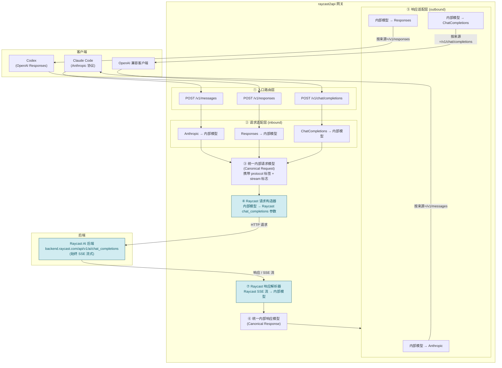
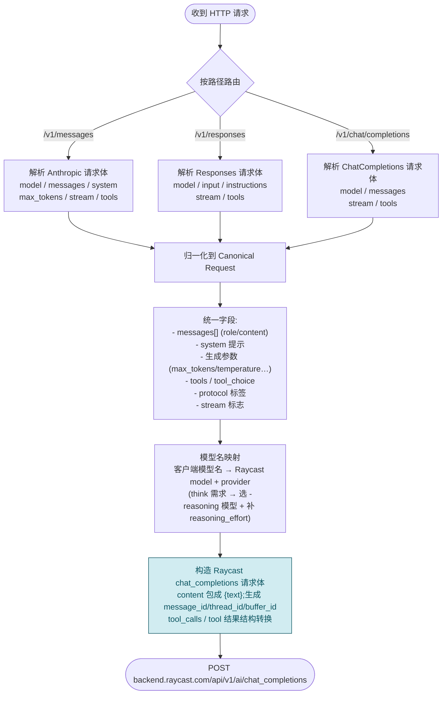
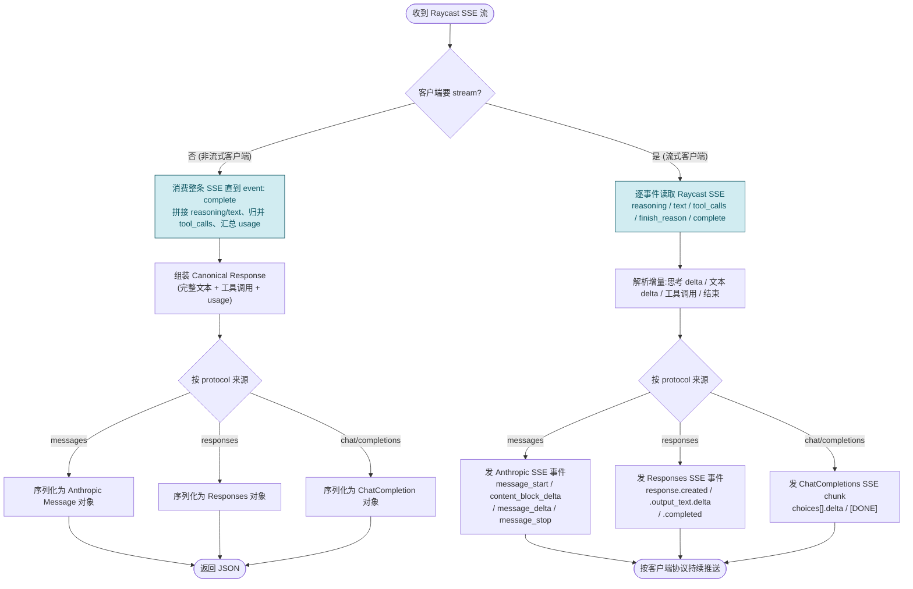

# raycast2api 架构与流程图

> 目标:作为**协议转换中间层**,把 Claude Code(Anthropic 协议)与 Codex / OpenAI 兼容客户端(OpenAI 协议)的标准请求,转换为 Raycast AI 后端所需的参数;再把 Raycast 的响应按**请求来源路径**反向转换回 Anthropic 或 OpenAI 协议。
>
> ✅ **Raycast AI 后端协议已抓包确认**,详见 [`raycast-backend-protocol.md`](./raycast-backend-protocol.md)。核心事实:后端接口为 `POST https://backend.raycast.com/api/v1/ai/chat_completions`,**始终以 SSE 流式返回**(请求体无 `stream` 字段);"非流式"由网关聚合流后一次性返回。

---

## 1. 支持的入口路径

| 路径 | 协议族 | 典型客户端 | 说明 |
| --- | --- | --- | --- |
| `POST /v1/messages` | Anthropic 标准 | Claude Code | Anthropic Messages API |
| `POST /v1/responses` | OpenAI 标准 | Codex | OpenAI Responses API |
| `POST /v1/chat/completions` | OpenAI 兼容 | 各类 OpenAI 兼容客户端 | OpenAI Chat Completions API |

三种路径均需同时支持 **流式(SSE)** 与 **非流式** 响应。协议判定**以路径为准**(而非请求头/字段探测)。

---

## 2. 总体架构

**核心设计:统一内部模型(Canonical Model)**
- 三种入口协议先各自转成同一个 `Canonical Request`,后端只需对接一种内部表示。
- 内部请求上携带 `protocol`(来源路径)与 `stream` 标志,响应阶段据此选择正确的 outbound 适配器,保证"从哪条路径进来,就按哪条路径的协议出去"。
- 新增/替换后端(如 Raycast 协议变更)只影响 ④ 与 ⑦,不触碰入口与出口适配。

---

## 3. 请求方向转换流程(inbound)

**要点**
- 三种协议的消息结构差异在归一化阶段抹平(如 Anthropic 的 `system` 顶层字段、Responses 的 `instructions` / `input`、ChatCompletions 的 `messages[0].role=="system"`)。
- Raycast 的 `messages[].content` **必须**是对象 `{text}`;思考历史作为独立 assistant 消息用 `<think>...</think>` 承载。
- 模型名映射表把客户端模型名映射到 Raycast `model` + `provider`(anthropic/openai);需要思考时选带 `-reasoning` 后缀的模型并补 `reasoning_effort`。
- 工具调用回程需做结构转换:SSE 里是扁平 `{name,arguments,id}`,写回请求 `messages[].tool_calls` 时是嵌套 `{id,type:"function",function:{name,arguments}}`。
- 字段细节以 [`raycast-backend-protocol.md`](./raycast-backend-protocol.md) 为准。

---

## 4. 响应方向转换流程(outbound)

**要点**
- 后端**永远流式**,所以 NS1/S1 都在消费同一种 Raycast SSE;区别只是"是否为客户端聚合"。
- 非流式客户端:消费完整条 SSE(直到 `event: complete`)→ 组装内部响应 → 一次性序列化为目标协议 JSON。
- 流式客户端:把 Raycast 的增量事件实时翻译成目标协议的 SSE 事件序列。三种协议的 SSE **事件命名与结构差异较大**,由各自 outbound 适配器负责:
  - **Anthropic**:`message_start` → 多个 `content_block_start/delta/stop`(思考走 `thinking_delta`,正文走 `text_delta`) → `message_delta` → `message_stop`
  - **OpenAI Responses**:`response.created` → `response.output_text.delta` → `response.completed`(事件名带类型)
  - **OpenAI ChatCompletions**:连续 `data: {chunk}`,以 `data: [DONE]` 结束
- **provider 无关**:Raycast 出站 SSE 无论 anthropic/openai 都用 `reasoning`+`text` 字段,出站适配器只按**客户端来源协议**分支,不按 provider 分支。
- `usage` 映射:Raycast 的 `input_tokens`/`output_tokens`/`cached_tokens` → Anthropic 同名;OpenAI 系换算为 `prompt_tokens`/`completion_tokens`(+`prompt_tokens_details.cached_tokens`)。`finish_reason`(`stop`/`tool_calls`)按各协议字段名映射。

---

## 5. 组件职责一览

| 编号 | 组件 | 职责 | 是否依赖 Raycast 协议 |
| --- | --- | --- | --- |
| ① | 入口路由层 | 按路径分发,校验鉴权/请求体 | 否 |
| ② | 请求适配层 | 三协议请求体 → 内部模型 | 否 |
| ③ | 内部请求模型 | 统一表示 + 来源标签 | 否 |
| ④ | Raycast 请求构造器 | 内部模型 → Raycast chat_completions 请求体 | **是**(见协议文档) |
| ⑤ | 响应适配层 | 内部模型 → 三协议(流/非流) | 否 |
| ⑥ | 内部响应模型 | 统一表示增量/完整响应 | 否 |
| ⑦ | Raycast 响应解析器 | Raycast SSE 流 → 内部模型 | **是**(见协议文档) |
| A1 | 账号存储 (`account/store`) | accounts 表 CRUD、轮询选号、可用性/冷却/额度字段 | 否 |
| A2 | 额度刷新 (`account/quota_refresh`) | 定时/手动拉 /me + /ai/credits + trial_status,决策可用性 | 是 |
| A3 | token 换新 (`account/token_renewal`) | 401 自动换新(rotation 原子落盘)、`invalid_grant` 判死 | 是(见协议文档 §6) |
| A4 | 账号 API (`server/handlers/accounts`) | 列表/单账号(live)/upsert/删除/恢复/手动刷新 | 否 |

> 依赖方向:`A2/A3 → A1`,`A4 → A2/A3/A1`;`raycast/client` 在 send_chat 的 401
> 分支调用 `A3`(经 `main` 装配注入,避免 raycast ↔ account 循环依赖)。
> 自动 token 刷新复用 `RaycastClient` 的共享 HTTP 客户端(含代理链)。

---

## 6. 抓包已确认 & 仍待补全

抓包(`charles/think_tools.har`)已确认的 Raycast AI 后端细节,详见 [`raycast-backend-protocol.md`](./raycast-backend-protocol.md):

1. ✅ **请求**:`POST https://backend.raycast.com/api/v1/ai/chat_completions`;鉴权 `Authorization: Bearer rca_<token>` + `x-raycast-*` 签名头;请求体字段(`model`/`provider`/`messages`(`content` 为 `{text}`)/`tools`/`tool_choice`/`reasoning_effort`/`system_instructions` 等)。
2. ✅ **响应**:**始终 SSE**(无 `stream` 开关);事件为 `reasoning`/`text` 增量、`tool_calls` 终结、`finish_reason`+`usage` 收尾、`event: complete` 终止。
3. ✅ **think vs 非 think**:think 模型名带 `-reasoning` + 有 `reasoning_effort`,响应含 `reasoning` 增量与 `thought_signature`。

仍待补全:

- ⏳ **签名算法** `x-raycast-signature-v2` 的计算方式(预期复用用户 token + deviceid)。
- ⏳ **完整模型清单**及各自 `provider`/是否支持 think(需抓模型列表接口)。
- ⏳ **错误响应结构**(本包无失败样本)。

> ④/⑦ 现已有明确实现依据;入口与出口协议适配层(①②③⑤⑥)与后端协议解耦,后端若变更只影响 ④/⑦。
