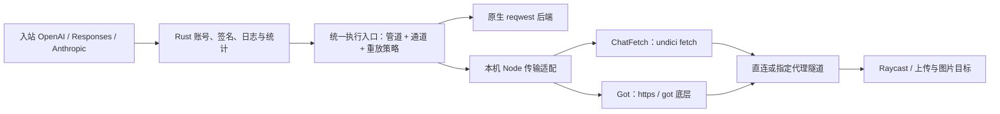

# Raycast 上游 TLS 指纹对齐实现方法

> 编写日期：2026-11-25。
> 依据：[客户端指纹快照](raycast-tls-fingerprint-2026-11-22.md)与当前项目代码、Cargo.lock、已安装的 reqwest 0.12.28 源码。
> 状态：已实现可选 Node 传输后端，2026-11-25 在 macOS arm64 完成双管道实际握手、公网 HTTP/2 回显及本地传输回归。启用方式与尚待验证的部署场景见 [实施与验收记录](raycast-tls-alignment-validation-2026-11-25.md)。本文保留设计依据，不改写原始观测记录。

## 1. 推荐结论

如果目标是对齐快照中的**完整 OpenSSL ClientHello，并尽量复用客户端的 HTTP/2 行为**，推荐：

**保留 Rust 网关业务层，增加可选的、常驻的 Node 同栈上游传输进程；聊天走 undici fetch，其余端点走 Node https/got 底层。**

Rust 继续负责签名、账号池、代理通道顺序、计费统计、错误分类和 SSE 协议转换。Node 只负责指定通道的一次上游请求及响应流转发。通过一个传输适配层接入，不在各业务方法里分散调用 Node。

推荐基于三个条件：

1. 目标是 Node/OpenSSL，而不是浏览器/BoringSSL；复用相同协议栈比跨栈手工仿造更可靠。
2. 现有业务代码大量使用 reqwest Request/Response，局部适配能减少 SSE、账号与统计模块的改动。
3. 快照同时包含 TLS 和 HTTP/2 特征；只换 TLS 库无法自然获得 undici 的 HTTP/2 行为。

**先完成运行时与代理出口的指纹验证，再接入业务。** 同一 Node 主版本、甚至同一版本号，都不能替代实际 ClientHello 验收。macOS arm64 已验证首次连接；Linux 构建由镜像内测试逐架构准入，本次未在本地运行 Docker。

如果部署必须只有一个 Rust 二进制，次选是固定 OpenSSL 构建的 Rust transport；如果只要求改善部分指纹而允许完整 JA3 不同，可以评估 wreq。两者的验收目标应明确区分。

## 2. 对齐目标与快照修正

### 2.1 两套出口

| 维度 | ChatFetch | Got |
| --- | --- | --- |
| 端点 | `/ai/chat_completions`，包含恢复请求 | models、me、credits、trial_status、文件注册、OAuth、预签名 PUT |
| 协议栈 | Node + OpenSSL + undici | Node + OpenSSL + https/got |
| HTTP | 支持 h2，保留 HTTP/1.1 协商回退 | HTTP/1.1 |
| ClientHello ALPN | 顺序为 `http/1.1, h2` | 整个 ALPN 扩展不存在 |
| JA3 | `d67b094811e5145139d7cea5f014309f` | `944d1e1858cd278718f8a46b65d3212f` |
| JA4 | `t13d5212h1_b262b3658495_8e6e362c5eac` | 规范形式预期为 `t13d521100_b262b3658495_8e6e362c5eac`，待原始回显复核 |
| HTTP/2 Akamai | `2:0;4:262144\|458753\|0\|a,m,p,s` | 不适用 |

共同目标：52 个密码套件及其顺序、supported_groups 的完整顺序、扩展顺序、`ec_point_formats=0-1-2`、TLS 支持版本、签名算法和 key_share 行为。

已用快照中的完整 JA3 字符串重新计算：聊天 JA3 MD5 与原文一致；仅删除扩展 `16` 后，got 的 MD5 也与原文一致；JA4 密码套件摘要为 `b262b3658495`。但原文没有列出 signature_algorithms 的完整内容，因此还不能独立重算 JA4 最后一段，也不能仅凭 JA3 还原全部扩展负载。

### 2.2 不能把 HTTP 版本等同于 ALPN 对齐

原快照 §4.2 写到 got 的 `http1_only()` 不发 ALPN。当前依赖的静态代码核查表明：

- reqwest 0.12.28 `async_impl/client.rs` 的 rustls 默认配置分支，在 `HttpVersionPref::Http1` 下设置 `alpn_protocols = ["http/1.1"]`。
- ChatFetch 默认设置为 `["h2", "http/1.1"]`，顺序与快照相反。
- `connect.rs` 对 HTTPS 代理外层连接会清空 ALPN；这不能说明目标站点的内层 TLS 没有 ALPN。

所以当前项目已按管道区分 HTTP 版本能力，但两套 TLS ALPN 均不能视为完成对齐。此结论来自锁定版本源码，本次没有对运行中的网关重新抓包。

### 2.3 got 的 JA4 格式需要补齐

JA4 规范规定：无 ALPN 扩展时对应字段为 `00`。本次本地解析实际握手得到表中的完整 got JA4；公网 tls.peet.ws 仍返回原文的 `t13d5211_...` 简写。因此需要区分规范格式与回显工具格式，不能只凭长度认定原始观测错误。[JA4 技术规范](https://github.com/FoxIO-LLC/ja4/blob/main/technical_details/JA4.md)

聊天 JA4 中的 `h1` 表示**客户端 ALPN 列表首项**为 `http/1.1`，不表示最终协商一定使用 HTTP/1.1。HTTP/2 Akamai 指纹描述 SETTINGS、窗口及伪头顺序等 HTTP/2 行为，属于独立验收项。

### 2.4 原始证据的边界

快照使用客户端内嵌 Node 请求回显服务，并结合 `index.mjs` 默认选项推定真实业务管道；它不是对所有真实端点逐一抓包的记录。正式实现前，优先补齐真实聊天和一个 got API 的原始抓包或同条件回显。

至少归档：完整 ClientHello、signature_algorithms、supported_versions、key_share 的组与长度、ALPN、完整 HTTP/2 帧摘要，以及新连接和会话恢复两种场景。JA3/JA4 一致也不能证明所有可观察行为一致。

## 3. 当前项目的接入位置

当前 Cargo.lock：reqwest `0.12.28`、rustls `0.23.43`、hyper `1.11.1`、h2 `0.4.20`。

| 文件 | 当前职责 | 实施时的处理 |
| --- | --- | --- |
| `src/proxies.rs` | 模式校验、两套客户端构造、通道顺序、代理标签脱敏 | 保留策略；补充 Node 通道描述和能力校验 |
| `src/raycast/client.rs` | 请求头、签名、模型/账号查询、聊天、文件上传 | 保留请求构造；将所有实际执行交给适配入口 |
| `src/raycast/transport.rs` | 请求执行、代理轮换、响应头超时、Attempt 绑定、OAuth 单通道 | 主要接入点；区分业务管道与传输后端 |
| `src/raycast/peek.rs` | SSE 首段窥探与响应重建 | 保持 reqwest Response 接口，验证字节回放及 Attempt 延续 |
| `src/raycast/stream.rs` | SSE 解码、断流处理、有限重试、生成图片下载 | 接入下载入口；保留有效输出后的断流语义 |
| `src/account/dispatcher.rs` | 账号选择、故障分类、重发 | 保持业务策略；识别传输进程不可用，避免误摘账号 |
| `src/error.rs` | reqwest 错误转换 | 增加桥接错误分类，保留上游 HTTP 错误原义 |
| `src/config.rs` | 配置和超时 | 增加可选后端配置并做启动校验 |
| `Dockerfile` / CI | 构建与发布 Rust 镜像 | 增加固定 Node 运行时与启动管理，分别验证目标架构 |

有三个必须覆盖的执行路径：

1. `oauth_token()` 直接执行请求，不经过普通 `send()`；其 refresh token 轮换不能在结果不明时自动重放。
2. `upload_file()` 的预签名 PUT 当前直接执行 `self.http`，绕过代理通道顺序，代理模式下仍可能直连。迁移时应作为本次传输接入的一部分修正；PUT 失败默认不自动重放。
3. `fetch_channels()` 当前返回聊天池，生成图片下载在 `stream.rs` 直接执行。原快照没有充分覆盖该下载管道，先保留 ChatFetch 分类并列为待补测项，不能直接宣称其与真实客户端完全一致。

## 4. 方案比较

| 方案 | 完整 TLS 指纹 | HTTP/2 指纹 | 项目代价 | 判断 |
| --- | --- | --- | --- | --- |
| 调整 rustls | 套件能力、扩展构造与 OpenSSL 差异大 | 仍是 hyper/h2 行为 | 局部改动小，完整目标难满足 | 不作为完整对齐方案 |
| reqwest 改 native-tls | 取决于平台、系统 TLS 与构建 | 仍是 hyper/h2 | 看似简单，跨平台指纹不稳定 | 不推荐 |
| wreq 自定义 profile | 可精细调参，但完整 Node profile 未获验证 | 可配置更多 h2 参数，仍需逐项验收 | 类型迁移、C/C++ 构建及版本维护 | 部分仿真候选 |
| Rust + 固定 OpenSSL transport | 与目标同 TLS 家族，仍需配置和扩展验证 | 自行对齐 HTTP/2 实现 | 自建连接器、代理、池与解压，成本高 | 单二进制约束下次选 |
| Node 同栈传输进程 | 最有希望复现目标，取决于固定运行时实测 | 可复用对应 undici 行为 | 多一个运行时和进程，适配范围可控 | 完整对齐首选 |

### 4.1 为什么不直接照原文换 wreq

wreq 官方文档确实提供 cipher、curves、ALPN、扩展和 HTTP/2 的配置能力，但配置作用于 BoringSSL 系列后端。`cipher_list` 接受的是后端支持算法的选择表达式，不能凭名字增加后端没有实现的算法。[wreq TLS 文档](https://github.com/0x676e67/wreq/blob/main/_autodocs/api-reference/tls.md)

目标列表含 DHE、CCM 等套件，并包含 X448、FFDHE 组。核查标准 BoringSSL 的公开接口及套件表，其 TLS 1.2 密钥交换列举为 RSA/ECDHE/PSK，bulk cipher 列表也没有 CCM。这些能力与目标存在明显差异。[BoringSSL ssl.h](https://github.com/google/boringssl/blob/main/include/openssl/ssl.h)、[密码套件实现](https://github.com/google/boringssl/blob/main/ssl/ssl_cipher.cc)

这不是对所有 wreq 下游补丁版本的绝对不可行判定；本次没有编译验证其具体 btls 构建。它说明：**“可配置 cipher_list”不足以支撑“完整复现 52 个套件”的推荐。** 若后续选择 wreq，先固定发布版本和后端 revision，用最小 PoC 验证完整套件、组和扩展；有缺项就停止把它当作严格对齐方案，不通过只填写数字 ID 制造假握手能力。

也不建议直接全局替换 reqwest：当前账号调度、窥探重建、流式错误与测试都绑定 reqwest 类型，改动范围会超过客户端构造函数。

## 5. 推荐架构

`Transport::ChatFetch/Got` 继续表示客户端业务管道。新增独立的 `UpstreamBackend` 表示 `Native/Node`，两者不混为一个枚举。

Node 模式下，reqwest 仅用于构建请求以及连接本机传输服务；目标站点的 TLS 必须由 Node 发起。普通 CONNECT 代理仅转发网关自身的 TLS 字节，不能改变 rustls 指纹。

建议单实例网关管理一个常驻 Node 子进程，同容器运行，以 loopback HTTP/1.1 为初版 IPC。限制为本机监听并使用进程级随机鉴权；不映射或暴露该端口。Linux/macOS 后续可以换 Unix socket，初版不同时维护多种 IPC。

## 6. 实现步骤

### 第一步：建立运行时与指纹基线

快照报告的是 Node `26.13.1`、OpenSSL `3.5.9`、undici `8.12.4`、nghttp2 `1.70.0`。实施时已取得 Node 官方发行包和固定版本 undici，并校验发行包摘要、依赖完整性及实际运行时版本。

1. 从可信发行渠道取得候选运行时，记录来源、二进制 SHA256、平台和构建参数。
2. 实测 `process.versions`、默认 cipher 配置和 OpenSSL provider 配置，不能只看 `node --version`。Node 官方说明默认 cipher 列表与其构建有关。[Node TLS 文档](https://nodejs.org/api/tls.html#modifying-the-default-tls-cipher-suite)
3. 用该运行时的内置 `fetch` 测 ChatFetch，用 `https.request` 测 Got；分别验证全新连接、复用连接、会话恢复、h2 和 HTTP/1.1 服务端。
4. 在实际目标部署平台以及配置的代理出口重复测量。先比完整字段，再比摘要。
5. 只有候选通过目标 profile 验收，才冻结其版本、校验和与发布镜像。不能因 Windows 原二进制通过，就宣称 Linux 镜像也通过。

初版优先使用通过验收运行时的**内置 fetch**，避免额外安装不同版本 undici 后改变行为。需要自定义代理 dispatcher 时，才引入与目标验证相容的固定 undici 包；锁定 package-lock 和实际依赖，重新跑双管道验收。

got 底层可先用 `https.request`，不显式传 ALPN，显式使用独立 Agent。它可以复用 Node TLS 行为，但 got 的重定向、请求头与重试等高层默认行为仍须由适配层明确处理，不能认为换成 https 就完整复制了 got。

若候选运行时无法复现 TLS，暂停业务迁移，检查 cipher 编译配置、OpenSSL/provider、组顺序与扩展；若这些差异无法修正，改评估固定 OpenSSL 的 Rust transport。PoC 失败应留下结果，不能以“近似”替代完整对齐验收。

### 第二步：增加一个执行适配边界

建议新建：

- `src/raycast/upstream.rs`：一次执行的后端选择、通道描述、重放策略与结果类型。
- `src/raycast/node_transport.rs`：本机 IPC、元数据解析、响应重建与取消。
- `src/raycast/node_process.rs`：启动、运行时校验、进程状态和关闭。
- `transport/node/main.mjs`：传输服务入口。
- `transport/node/chat.mjs`、`got.mjs`、`proxy.mjs`：分别负责双管道与隧道连接。
- `transport/node/profiles/`：冻结的基线元数据与测量结果。

第一版保留 `reqwest::Request/Response` 作为 Rust 侧兼容类型。各执行路径调用统一的一次执行函数，由外层 `send()` 决定通道顺序；Node 收到的请求只含一个已选通道。

响应适配按已存在的重建方式构造 `http::Response<reqwest::Body>`，再转为 reqwest Response。这样账号层、SSE 窥探与解码仍可使用现有接口。Body 中的 IPC 或上游流错误必须继续作为流错误传播，不能被转换成正常 EOF。

### 第三步：定义内部流式协议

建议使用一个版本化的本机 `POST /v1/execute`，请求与成功响应都采用：

`4 字节大端 JSON 长度 + UTF-8 JSON 元数据 + 原始 body 字节流`

请求元数据包括：协议版本、关联 ID、管道、通道 ID、目标 URL、method、头字段列表、响应头/连接超时。代理账号密码在进程初始化时传入内存配置，请求只引用通道 ID。

约束如下：

- JSON 元数据上限建议 64 KiB，超限在发上游请求前拒绝。请求 body 继续遵守项目已有上传限制。
- 签名后的 body 原始字节直接复制，不在 Node 中 parse/stringify，也不把文件内容转成 base64。
- 头字段以列表编码，保留重复值；本机鉴权头、通道控制字段绝不进入上游请求头。
- 成功获得上游响应头时，本机 HTTP 返回 200，帧元数据携带真实上游 status、headers、URL、协议和 body 编码状态，后续立即转发 body。
- 上游 401/403/429/5xx 都属于上述“已获得响应”，不能作为本机执行失败；Rust 重建为真实状态码后继续原业务分类。
- 发上游请求前失败或尚未收到响应头的传输失败，本机使用非 2xx 和结构化错误，包含阶段及是否已开始上游发送。两类状态不能混淆。
- 响应头已经转发后发生错误，销毁本机响应流；禁止正常结束流或附加桥接 JSON 破坏 SSE。
- Rust 解析元数据时可能读到部分 body，必须将多读的字节接回响应流，类似现有 peek 的回放机制。

重建响应后，在 Rust 侧绑定 `statistics::Attempt`，保持原来的创建、状态更新、取消和终结行为。桥接关联 ID 用于日志追踪，不成为额外计费 attempt。

### 第四步：落实双管道与连接池

| 行为 | ChatFetch | Got |
| --- | --- | --- |
| 起始实现 | 验收运行时内置 fetch | https.request + 独立 Agent |
| ALPN | 按实测默认；需要自定义时固定 `http/1.1, h2` | 不设置 ALPN，验收时确认扩展不存在 |
| HTTP/2 | 让匹配的 undici 实现负责 | 不启用 |
| 请求头 | Rust 已生成的头 + 已验收的自动头行为 | Rust 已生成的头，裸 PUT 不补 backend 默认头 |
| 连接复用 | 持久 dispatcher/pool | 持久 Agent |

当前 undici 主线 connector 的 `allowH2/preferH2` 会影响 ALPN 顺序：非 preferH2 分支为 `http/1.1, h2`。这是配置能力证据，不代表目标内嵌版本已按主线行为验证。[undici connector 源码](https://github.com/nodejs/undici/blob/main/lib/core/connect.js)、[Client 文档](https://github.com/nodejs/undici/blob/main/docs/docs/api/Client.md)

池至少按 `(管道, 通道 ID, 目标 origin, profile 版本)` 隔离，不能复用 Got TLS 连接给 ChatFetch；代理之间也不能共享连接。不要逐请求新建进程或 Agent。连接空闲回收以现有 20 秒策略为起点，同时记录实际 h2 session 生命周期。

HTTP/2 Akamai 验收包括 SETTINGS 的值与顺序、连接 WINDOW_UPDATE、PRIORITY 行为及 `a,m,p,s` 伪头顺序。不能用 Node 原生 `http2.connect()` 替代 undici 后，仍假设它们输出完全相同的 h2 指纹。

### 第五步：保持代理模式语义

现有模式继续生效：

- `direct`：只直连；Node 不读取系统代理来隐式改道。
- `proxy`：只按列表尝试代理，无直连回退。
- `proxy_fallback_direct`：列表耗尽后，才由 Rust 选择直连。

所有代理均需透传目标 TLS：

| 代理类型 | 链路 | 指纹检查点 |
| --- | --- | --- |
| HTTP | TCP 到代理 → CONNECT → Node TLS 到目标 | 隧道内的目标 ClientHello |
| HTTPS | TLS 到代理 → CONNECT → Node TLS 到目标 | 区分外层代理 TLS 和内层目标 TLS |
| SOCKS5 | SOCKS 协商 → Node TLS 到目标 | 隧道内的目标 ClientHello |

代理认证不能进入目标请求。隧道不能做 TLS 解密终止；如果代理本身中间人解密，目标看到的是代理指纹，Node 无法保证对齐。

原有 `socks5://` 的 DNS 解析语义也应核查并保持，不顺带改成另一种远程 DNS 策略。针对 got 使用自定义连接/Agent，针对 fetch 使用验收过的 dispatcher/connector；不能只将 fetch 的 ProxyAgent 套到所有端点，因为它可能给 Got 增加 ALPN。

三种代理协议均是启用 Node 模式前的必验项。暂不支持某种配置时启动失败并指出不支持的通道，禁止忽略配置或悄悄改直连。

### 第六步：保持流式、超时与重放策略

1. Rust 保留现有响应头等待和 SSE 分块读取超时。Node 为真实 DNS/TCP/代理/TLS 阶段设置连接截止时间；本机 TCP 连通不代表上游已连接。
2. 请求级总超时、连接超时、响应头超时、SSE 无数据超时分别处理，不能给聊天 body 套一个会提前切断长回答的固定总时限。
3. 转发使用有背压的 stream/pipeline，不能先调用 `text()` 或 `arrayBuffer()` 读完整个 SSE。Node 官方 pipeline 支持背压、错误清理及 AbortSignal。[Node Stream 文档](https://nodejs.org/api/stream.html#streampipelinesource-transforms-destination-callback)
4. 本机请求在响应结束前断开时取消对应上游请求；正常请求 body 已发送完的 close 事件不能误判为取消。取消必须按请求隔离，不能销毁整个共享 h2 池。
5. 有效内容输出后的断流，继续保留部分内容并显式报错，由客户端决定继续。Node 不内置自动聊天重试；无有效输出时的现有有限重试仍由 Rust 控制。
6. OAuth 只执行一个通道一次。发送结果不明、IPC 断开、进程重启均不能自动重放 refresh token。预签名 PUT 默认同样单次执行。
7. 普通 API 保留当前网络故障通道轮换和 HTTP 业务错误不轮换语义。新增本机进程不可用错误应快速结束请求，不能逐代理或逐账号重复请求同一个死进程。
8. 生成图片下载保留独立的 60 秒、20 MiB 上限及现有 HTTP 失败换通道逻辑；这些规则与 chat 的轮换规则不同，不能被通用执行器覆盖。

### 第七步：只解压一次

fetch 响应可能已经自动解压，而 https 的 IncomingMessage 通常提供原始压缩流。协议必须标明 body 是否解压：

- 已解压：去掉上游 `content-encoding` 和对应压缩 `content-length`，再重建 reqwest Response。
- 未解压：适配层流式解压后再提供给业务；支持当前显式声明的 gzip/br/deflate/zstd，并去掉失效长度与编码头。
- 本机 reqwest 客户端关闭自动解压，避免内部协议帧或已经解压的数据被二次处理。

上游请求 `accept-encoding` 继续使用现有两套顺序；不能为了方便解压改成 identity，造成请求行为与快照不一致。原始响应头供诊断记录，业务层得到的是与 body 对应的有效头。

## 7. 配置、进程与部署

已在 `config.json` 支持独立配置块；省略时继续使用原生传输：

| 字段 | 建议值/含义 |
| --- | --- |
| `upstream_transport.backend` | `native` 默认；显式 `node` 启用 |
| `upstream_transport.profile` | 如 `raycast-windows-2.13.1.0`，对应已验收 profile |
| `upstream_transport.node_path` | 受控运行时路径 |
| `upstream_transport.transport_dir` | 含 `main.mjs` 及固定依赖的目录，默认 `transport/node`，相对网关工作目录 |
| `upstream_transport.startup_timeout_secs` | 子进程启动及版本校验截止时间 |

本机端口与随机鉴权由进程管理器创建，不作为用户必填项。初始化握手返回实际运行时版本、profile、代理能力和内部协议版本；只比版本号不足以完成指纹验证。

`node` 模式不可用时快速报不可用，不自动换回 native。回滚通过显式改配置并重启完成；配置中的代理 fallback 只控制出口，不控制 TLS 后端。

部署实现需要：

- Docker 同时提供 Rust 与通过验收的固定 Node，避免 `node:latest` 或系统 apt 随机升级。按平台归档 SHA256 和测量结果。
- Rust 负责子进程的启动、有限退避重启、退出通知与关闭；Node 意外退出使在途请求明确失败，不恢复或重放在途 OAuth。
- 网关 SIGTERM 时停止接收新请求，按有限时间等待/取消在途请求，再关闭 Agent/dispatcher 和子进程，避免孤儿进程。
- `/health` 继续表示进程存活，`/ready` 在 Node 模式下先检查本机传输进程；保留原有账号判定与有限频率的上游探测。
- CI 增加固定依赖安装、Node 检查、跨进程契约测试和镜像启动测试。当前镜像发布流程未显式配置多平台，扩展架构时逐平台验证，不能复用另一架构的指纹结论。

严格 fingerprint 验证属于构建/发布准入或显式诊断，不在每次用户请求前访问公网回显服务。

## 8. 验收与交付顺序

### 8.1 分阶段交付

| 阶段 | 交付物 | 通过条件 |
| --- | --- | --- |
| A：可行性 | 固定运行时、双管道抓包、字段差异表 | 部署平台的 TLS 必需字段全部匹配；h2 单独列结果 |
| B：直连适配 | IPC、进程管理、统一执行入口 | 原有账号/SSE/统计行为通过，断流与取消无丢失 |
| C：代理与旁路 | 三种代理、OAuth、上传、图片下载接入 | 出口模式正确，每条通道指纹通过，无隐式直连 |
| D：发布 | 配置说明、固定镜像、回滚步骤、验收报告 | 镜像内验收与真实低额度 API 流程通过 |

### 8.2 传输与业务回归

必须覆盖：

- 双管道选择及连接隔离；got 没有 ALPN、chat 的 ALPN 顺序正确。
- 上游 401/403/429/500 与本机 503 分类不混淆；账号业务分类和 Attempt 不重复结算。
- 元数据及 SSE 跨块切分、peek 字节回放、响应头/body 错误、部分输出断流、取消。
- 慢消费者背压与并发请求内存上界，Node 进程退出后的快速失败。
- 三种代理及三种模式，HTTPS 代理内外层 TLS 分开取证，上传不绕过模式。
- OAuth 模糊失败不重放；预签名 PUT 保留 URL、签名参数和服务端头，不附加 backend UA/Authorization。
- 四种响应编码及解压后的长度处理；图片下载大小上限。
- native 模式的现有相关测试继续通过。

新增测试放在传输服务与 Rust 适配边界，复用已有 transport/peek/stream 和 statistics 测试，不重写全部业务测试。TLS 指纹测试不能用只返回假 JA3 字符串的 mock 代替真实握手。

### 8.3 指纹验收矩阵

对 ChatFetch/Got 分别测试直连、HTTP/HTTPS/SOCKS5 代理。每类至少包括：全新连接、同连接复用、会话恢复后的新连接；ChatFetch 增加 h2 和 HTTP/1.1 协商场景。

验收报告记录完整字段差异、摘要、目标 origin、运行时及二进制版本、代理类型与观测条件。会话恢复会改变 ClientHello 扩展，不能强行要求其与首次握手具有同一个 JA3；应与真实客户端的对应连接状态比较。

抓包/回显成功证明传输特征；真实 models、me、OAuth、文件上传及聊天 SSE 成功证明业务可用。两者不能互相替代，也不能由它们推定“绕过了上游风控”。原始文档仍然没有提供上游已执行 TLS 指纹校验的证据。

## 9. 最终实施边界

本次实现的目标应定义为：

**增加经过验收的 Node 上游传输后端，让现有两套业务管道在直连和配置代理下使用对应的 Node/OpenSSL TLS 行为，保留现有 Rust 业务语义，并通过可重复的握手与业务回归验证。**

开始编码前最关键的交付物是阶段 A 的差异表。它决定固定哪个运行时、是否需要外置 undici、哪些高层自动行为要显式设置，以及 HTTP/2 对齐是否确实成立。没有这份证据，直接迁移传输库只能算更换 TLS 栈，不能算完成指纹对齐。
