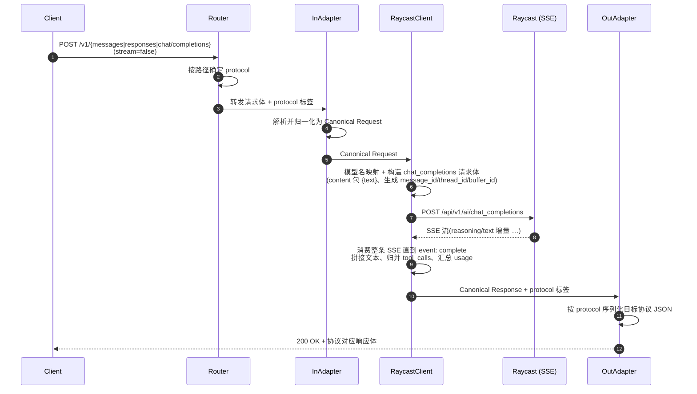
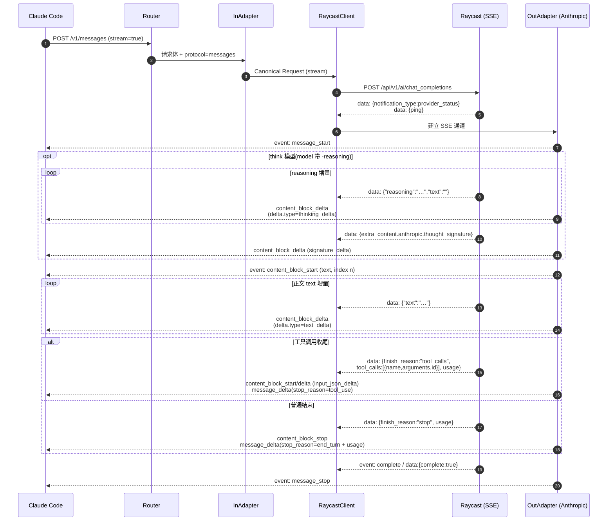
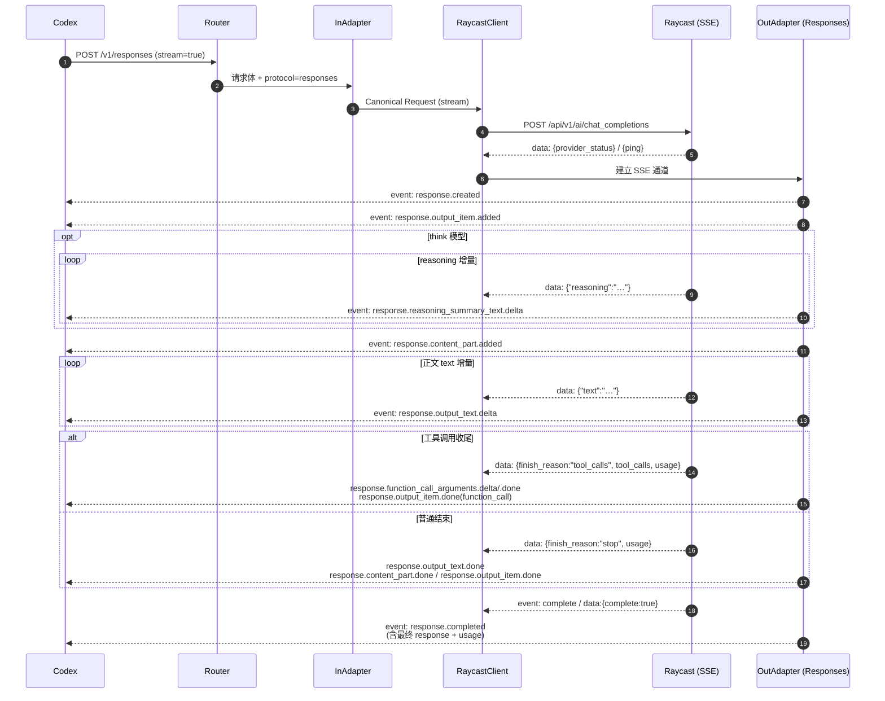
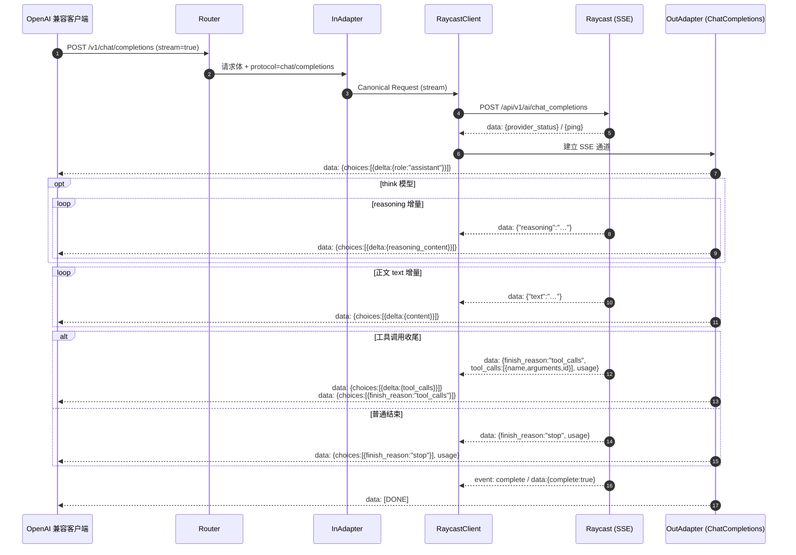
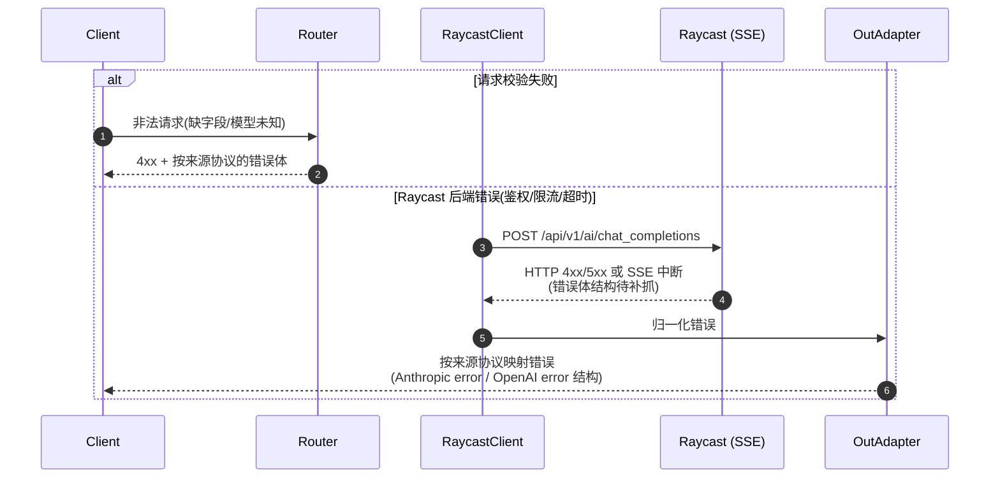

# raycast2api 时序图

> 覆盖三种入口路径 × (非流式 / 流式) 的请求-响应时序。
>
> ✅ 与 Raycast AI 后端交互的部分已按抓包结果落实,详见 [`raycast-backend-protocol.md`](./raycast-backend-protocol.md)。
> **关键前提:Raycast 后端始终以 SSE 流式返回**,请求体无 `stream` 字段。"非流式客户端"由网关消费完整 SSE 后聚合返回。

参与者说明:
- **Client**:Claude Code / Codex / OpenAI 兼容客户端
- **Router**:入口路由层(按路径分发)
- **InAdapter**:请求适配层(协议 → 内部模型)
- **RaycastClient**:Raycast 请求构造 + 调用 + SSE 解析(④⑦)
- **OutAdapter**:响应适配层(内部模型 → 协议)
- **Raycast**:Raycast AI 后端(`POST /api/v1/ai/chat_completions`,始终 SSE)

---

## 1. 非流式(客户端 stream=false)

三条路径非流式流程结构一致,差异仅在 InAdapter / OutAdapter 的协议序列化。
**注意:即便客户端要非流式,网关对后端仍发起 SSE 请求,并在内部把整条流聚合成完整响应。**

**各协议非流式响应体形态**

| 来源路径 | 顶层对象 | 正文字段 | 结束字段 | usage 字段 |
| --- | --- | --- | --- | --- |
| `/v1/messages` | `type: "message"` | `content[].text` | `stop_reason` | `usage.input_tokens/output_tokens` |
| `/v1/responses` | `object: "response"` | `output[].content[].text` | `status` | `usage.input_tokens/output_tokens` |
| `/v1/chat/completions` | `object: "chat.completion"` | `choices[].message.content` | `choices[].finish_reason` | `usage.prompt_tokens/completion_tokens` |

---

## 2. 流式 · Anthropic(`/v1/messages`)

---

## 3. 流式 · OpenAI Responses(`/v1/responses`)

---

## 4. 流式 · OpenAI ChatCompletions(`/v1/chat/completions`)

---

## 5. 错误处理时序(通用)

**错误结构映射**

| 来源路径 | 错误响应结构 |
| --- | --- |
| `/v1/messages` | `{ "type": "error", "error": { "type", "message" } }` |
| `/v1/responses` | `{ "error": { "message", "type", "code" } }` |
| `/v1/chat/completions` | `{ "error": { "message", "type", "code" } }` |

> 流式场景下,若已建立 SSE 通道后才出错,需按各协议的流内错误事件(如 Anthropic 的 `event: error`)推送,而非改 HTTP 状态码。

---

## 6. 备注

- 以上时序中 Raycast 侧的事件(`provider_status`/`ping`、`reasoning`/`text` 增量、`tool_calls` 终结、`finish_reason`+`usage`、`event: complete`)均已按抓包 `charles/think_tools.har` 落实,字段细节见 [`raycast-backend-protocol.md`](./raycast-backend-protocol.md)。
- **后端只有 SSE 一种形态**:Client 侧要非流式时,由 RaycastClient 消费整条 SSE 后聚合;要流式时逐事件翻译。两条路径共用同一份 SSE 解析器。
- **provider 无关**:Raycast 出站 SSE 无论 anthropic/openai 都用 `reasoning`+`text` 字段,OutAdapter 只按客户端来源协议分支。
- 三种协议的 SSE 事件模型差异集中在 OutAdapter,是本项目转换逻辑的核心复杂点,建议实现时对每种协议单独编写事件状态机。
- 仍待补抓:`x-raycast-signature-v2` 签名算法、完整模型清单、后端错误响应结构。
